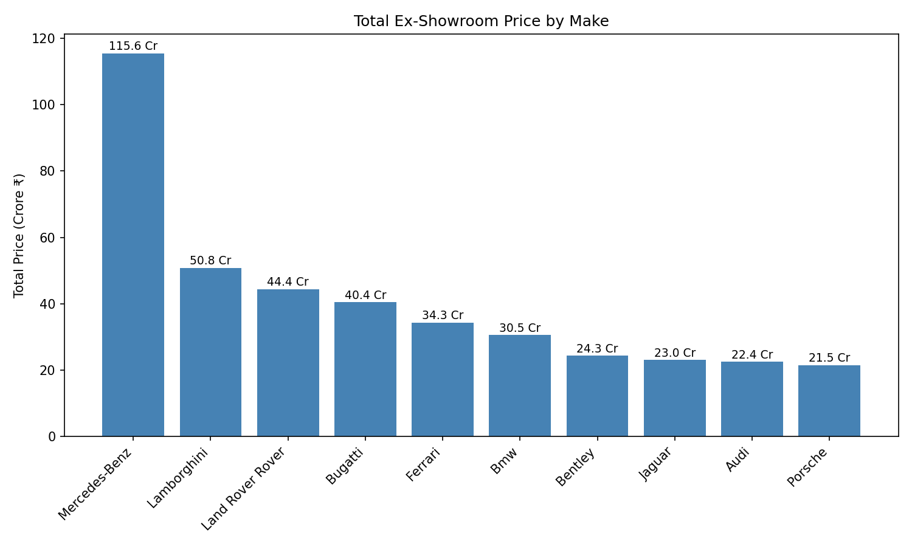
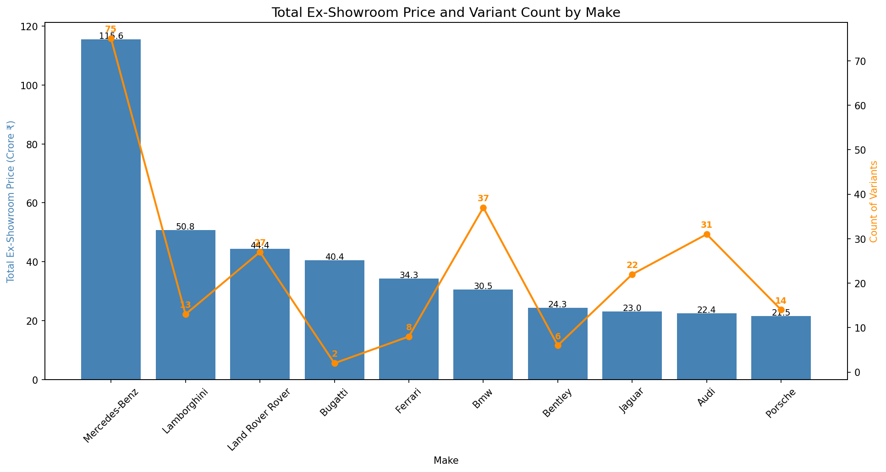
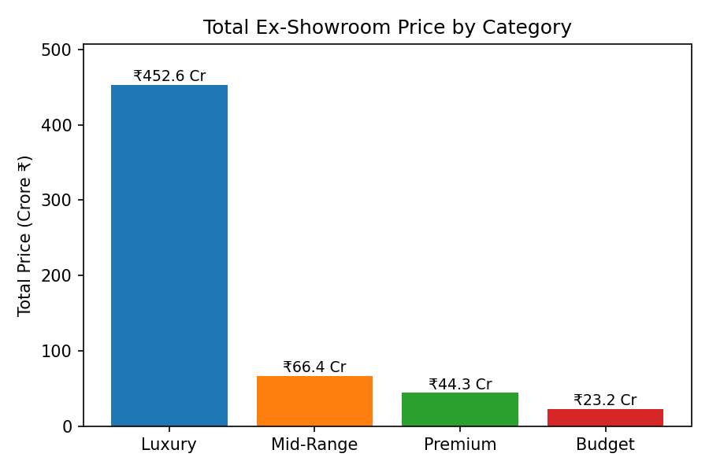
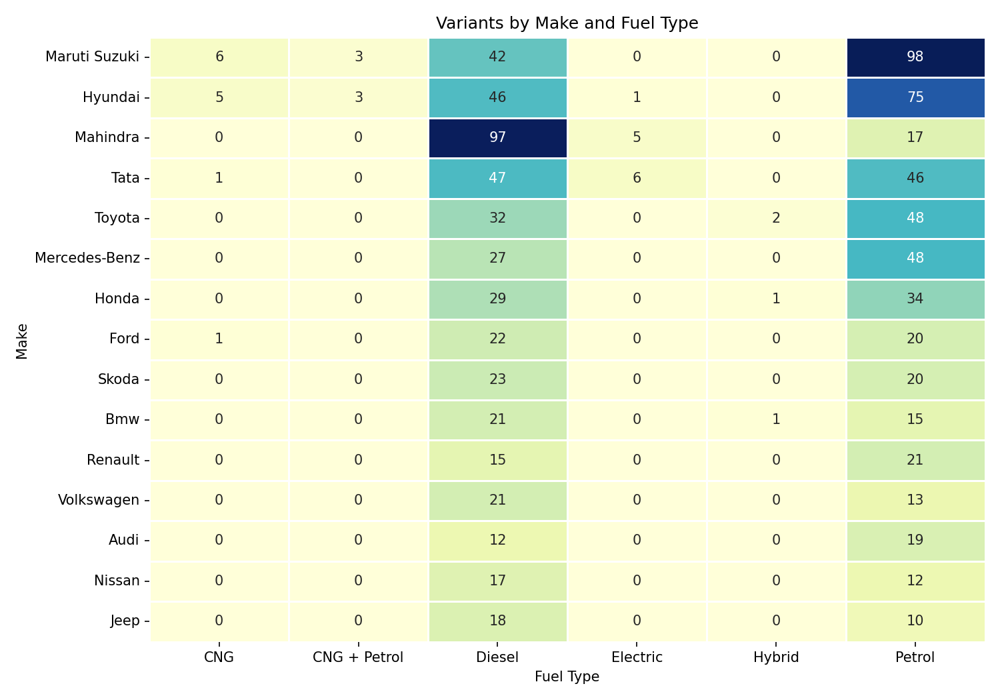
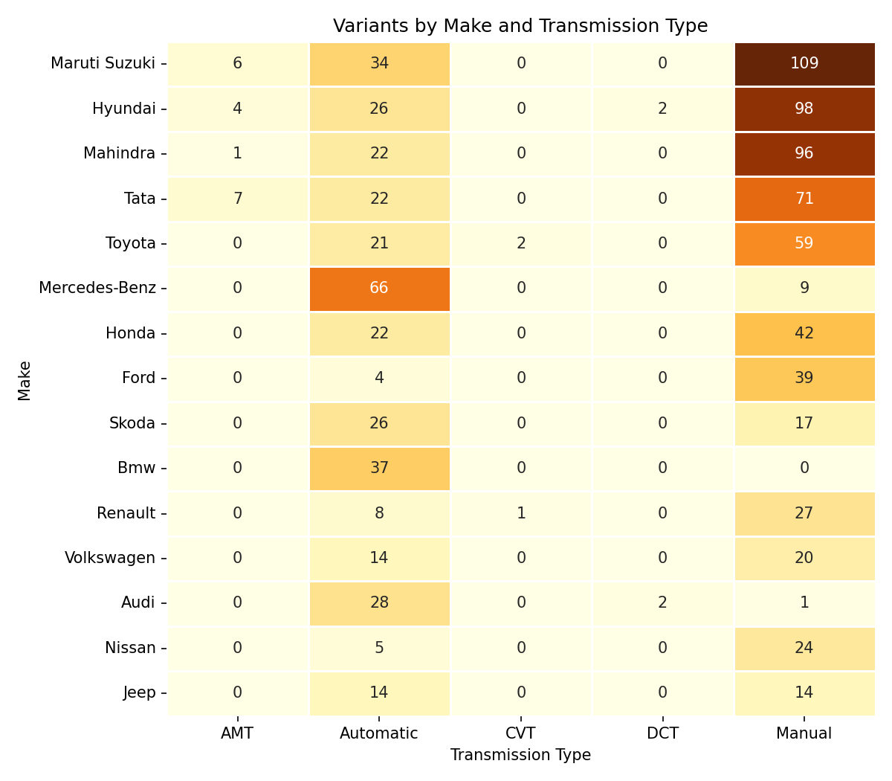

# 🚗 Indian Car Market Analysis

An end-to-end exploratory data analysis project on the Indian car market. It explores ex-showroom prices, brand categories, fuel types and transmission types across car makes, using Python for the analysis and Excel for the initial understanding of the data.


---

## 📌 Overview

This project takes a raw Indian car dataset and builds a complete analysis, covering:

- **Data understanding** in Excel: filters, column checks, price ranges and unit checks
- **Data cleaning** in Python: duplicates, missing values and unclear column names
- **Aggregation** of total ex-showroom price and variant count by make and by category
- **Cross-tabulation** of make vs fuel type and make vs transmission type
- **Visualization** of the results with bar charts and heatmaps

Built to practice real-world data analyst skills: asking business questions first, cleaning data carefully, and presenting findings with clear charts.

> **Note:** The dataset contains specifications and pricing for each variant. It has no units-sold column, so **Count** in this project means the *number of variants*, not sales volume.

## ❓ Business Questions

| # | Question |
|---|----------|
| 1 | Which car brands have the highest total ex-showroom value? |
| 2 | How is the market split across Budget, Mid-Range, Premium and Luxury? |
| 3 | Which brands offer Petrol, Diesel or CNG variants? |
| 4 | Which brands offer Manual, AMT or Automatic transmissions? |

## 🗂️ Dataset

| Item | Details |
|------|---------|
| Format | CSV |
| Raw file | `Data/Raw_data/Indian_car_Raw_data.csv` |
| Cleaned file | `Data/Cleaned_data/Indian_car_Cleaned_data.csv` |

**Main columns used:**

| Column | Description |
|--------|-------------|
| `Make` | Car brand (Hyundai, Tata, BMW and so on) |
| `Model` / `Variant` | Car model and its variant |
| `EX- Showroom Price` | Ex-showroom price in rupees |
| `Ex- Showroom (Lakhs)` | Ex-showroom price in lakhs (renamed from `Column1`) |
| `Fuel_Type` | Petrol, Diesel, CNG and so on |
| `Type` | Transmission type (Manual, AMT, Automatic) |
| `Category` | Budget, Mid-Range, Premium or Luxury |
| `Displacement`, `Cylinders`, `Power`, `Torque`, `Seating` | Engine and body specifications |

## ⚙️ Tech Stack

- **Python**: core analysis
- **Pandas**: data loading, cleaning, grouping and cross-tabulation
- **NumPy**: numerical operations
- **Matplotlib**: bar charts
- **Seaborn**: heatmaps
- **Microsoft Excel**: understanding the data before the Python analysis
- **VS Code**: development environment
- **Git and GitHub**: version control

## 📁 Project Structure

```
Indian-Cars-Data-Analysis/
├── Data/
│   ├── Raw_data/
│   │   └── Indian_car_Raw_data.csv        # original dataset
│   └── Cleaned_data/
│       └── Indian_car_Cleaned_data.csv    # cleaned dataset
├── images/                                # saved charts
├── main.py                                # full analysis script
├── requirements.txt                       # Python libraries
└── README.md
```

## 🔄 Project Workflow

1. **Understand the data in Excel.** Opened the raw file, applied filters, and checked columns, price values and units. This is where the unclear `Column1` was found to be the price in lakhs.
2. **Clean the data.** Checked duplicates and missing values, and renamed `Column1` to `Ex- Showroom (Lakhs)`.
3. **Load into Python.** Read the cleaned CSV with Pandas and inspected the shape, data types and missing values.
4. **Analyse.**
   - Grouped by `Make` for variant count and total ex-showroom price
   - Grouped by `Category` to compare segments
   - Built Make vs Fuel Type and Make vs Transmission cross-tabs
5. **Visualize.** Created bar charts and heatmaps and saved them to `images/`.
6. **Draw insights.** Summarised the results below.

## 📊 Sample Output

### Total Ex-Showroom Price by Make


### Total Price and Variant Count by Make


### Total Ex-Showroom Price by Category


### Variants by Make and Fuel Type


### Variants by Make and Transmission Type


## 💡 Key Findings

- **Mercedes-Benz** has the highest total ex-showroom value (about Rs 115.6 Cr across 75 variants), largely because it has many variants in the dataset.
- **Lamborghini** (13 variants) and **Bugatti** (only 2 variants) rank high on total value despite few variants, which points to very high prices per variant.
- **Luxury** accounts for the largest total value (about Rs 452.6 Cr), followed by Mid-Range (about Rs 66.4 Cr), Premium (about Rs 44.3 Cr) and Budget (about Rs 23.2 Cr).
- The fuel heatmap shows which brands offer Petrol, Diesel and CNG variants.
- The transmission heatmap shows which brands offer Manual, AMT and Automatic variants.

## 🧠 Key Design Decisions

- **Excel first, Python second.** Exploring the data in Excel first exposed unit and naming problems before any code was written.
- **Totals and counts together.** A total alone is misleading, because brands with more variants have bigger totals. Showing the variant count beside the total keeps the comparison honest.
- **Crore conversion.** Prices were converted to crore for the charts, so large numbers stay readable.
- **Honest labelling.** Since there is no sales volume in the data, "Count" is described as variants everywhere instead of being presented as units sold.


## 🔮 Future Improvements

- Add average and median price per make for a fairer brand comparison
- Analyse price against engine power, displacement and torque
- Compare Manual vs Automatic price differences
- Add real sales volume data (for example from SIAM) to study market share
- Build an interactive dashboard in Power BI or Streamlit
- Predict car price from specifications with a machine learning model

## 👤 Author

**Mehul Vishwakarma**
[LinkedIn](https://www.linkedin.com/in/mehul-vishwakarma-9a1b2431a/) · [GitHub](https://github.com/MehulVi)